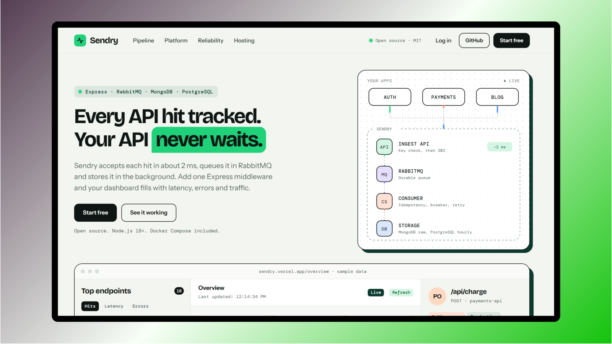

# 🚀 Sendry  - Event-Driven API Observability Platform

A self-hosted API observability platform designed to capture, process, and analyze API events through asynchronous event-driven architecture.

## Built With

  
  <strong>Node.js</strong>
  &nbsp;&nbsp;&nbsp;
  
  <strong>React</strong>
  &nbsp;&nbsp;&nbsp;
  
  <strong>RabbitMQ</strong>

  
  <strong>MongoDB</strong>
  &nbsp;&nbsp;&nbsp;
  
  <strong>PostgreSQL</strong>
  &nbsp;&nbsp;&nbsp;
  
  <strong>Docker</strong>

 

[Overview](#platform-overview) •
[Architecture](#system-architecture) •
[Ingestion Flow](#request-ingestion-sequence) •
[Engineering](#core-system-design) •
[Metrics](#engineering-metrics) •
[Trade-offs](#system-design-trade-offs)

---

## Platform Overview

Sendry is a self-hosted API monitoring and analytics platform that captures API request telemetry, processes events asynchronously, stores request logs, and provides aggregated analytics through a dashboard.

### The Problem

Traditional monitoring implementations can introduce unnecessary overhead when telemetry collection and database operations happen directly within an application's request lifecycle.

This creates several engineering challenges:

- **Request overhead:** Synchronous telemetry processing can increase API response latency.
- **Database bottlenecks:** Storing and querying large volumes of raw request events can become expensive.
- **Traffic spikes:** Direct database writes may struggle with sudden increases in event volume.
- **Operational costs:** Commercial observability platforms can become expensive as monitoring volume grows.

### The Solution

Sendry separates telemetry ingestion from background processing using RabbitMQ as an asynchronous message broker.

It uses a dual-database architecture:

- **MongoDB** stores raw API request events.
- **PostgreSQL** stores pre-aggregated analytics and time-series metrics.

This architecture keeps database persistence outside the monitored application's response path and allows ingestion, processing, storage, and analytics to operate independently.

### Product Overview

---

## Key Features

- **Asynchronous Event Ingestion:** Captures API telemetry without waiting for background database writes.
- **Message Queue Processing:** Uses RabbitMQ to buffer incoming events and separate ingestion from persistence.
- **Background Workers:** Processes queued events independently of the ingestion API.
- **Raw Request Logging:** Stores request telemetry and metadata in MongoDB.
- **Pre-Aggregated Analytics:** Maintains hourly analytics using PostgreSQL UPSERT operations.
- **Circuit Breaker:** Protects ingestion from prolonged message broker failures.
- **Retry with Jitter:** Uses exponential backoff with randomized delays for transient database failures.
- **Dead-Letter Queue:** Routes messages that cannot be processed successfully to a separate queue.
- **Duplicate Filtering:** Uses bounded in-memory deduplication and MongoDB uniqueness constraints.
- **API Key Security:** Supports scoped API keys and optional IP and origin restrictions.
- **Analytics Dashboard:** Visualizes API performance and request metrics through React.

---

## System Architecture

Sendry separates telemetry ingestion, message buffering, background processing, persistence, and analytics into independent components.

### Architecture Components

| Component | Responsibility |
|---|---|
| Monitored Application | Handles application requests and generates API telemetry. |
| Sendry SDK | Captures request metadata, calculates latency, and submits telemetry asynchronously. |
| Ingest API | Validates API keys and publishes incoming events to RabbitMQ. |
| RabbitMQ | Buffers telemetry events between ingestion and processing. |
| Background Worker | Consumes queued messages and coordinates persistence. |
| MongoDB | Stores raw API request events and metadata. |
| PostgreSQL | Stores hourly pre-aggregated analytics. |
| React Dashboard | Displays API monitoring and analytics data. |

### Data Processing Responsibilities

**Ingestion Layer**

Responsible for receiving telemetry, validating credentials, and publishing messages to RabbitMQ.

**Processing Layer**

Responsible for consuming messages, handling failures, applying retry strategies, and coordinating database writes.

**Storage Layer**

Separates raw event storage from structured analytical data.

**Presentation Layer**

Retrieves analytical data and presents it through the React dashboard.

---

## Request Ingestion Sequence

The ingestion pipeline is designed to keep telemetry collection outside the monitored application's response lifecycle.

### Request Lifecycle

1. **Incoming Request:** A client sends an HTTP request to the monitored application.
2. **Response Monitoring:** Sendry SDK middleware observes the response `finish` event.
3. **Latency Calculation:** Request duration is calculated using `process.hrtime()`.
4. **Application Response:** The monitored application sends its response to the original client.
5. **Asynchronous Submission:** The SDK schedules a telemetry POST request using `setImmediate()`.
6. **Credential Validation:** Sendry Ingest API validates the incoming API key.
7. **Message Publishing:** The ingestion API publishes the telemetry payload to RabbitMQ using publisher confirm channels.
8. **Ingestion Acknowledgement:** The ingestion API returns `202 Accepted` to the SDK after successful publishing.
9. **Background Processing:** The worker consumes the queued event.
10. **Data Persistence:** Raw request data is stored in MongoDB, while analytical metrics are updated in PostgreSQL.

The monitored application does not wait for the worker or database persistence to complete.

---

## Core System Design

The following engineering decisions address failure isolation, asynchronous processing, database efficiency, and message reliability.

### 1. Ingestion-Side Circuit Breaker

RabbitMQ failures must not cause the monitored application's request lifecycle to wait indefinitely.

Sendry implements a circuit breaker with three states:

| State | Behavior |
|---|---|
| CLOSED | Normal message publishing is allowed. |
| OPEN | Message publishing is stopped after the configured failure threshold. |
| HALF-OPEN | A limited number of probe messages are used to test broker recovery. |

**Configured behavior:**

- Failure threshold: 5 broker failures within a 10-second window.
- OPEN cooldown: 30 seconds.
- HALF-OPEN probes: 3 messages.
- Successful recovery: Returns to CLOSED.
- Failed recovery: Returns to OPEN.

When the breaker is OPEN, the ingestion API rejects telemetry rather than waiting on an unavailable broker. The monitored application's original HTTP response remains independent of this failure.

Implementation: `CircuitBreaker.js`

### 2. Exponential Backoff with Jitter

Temporary database failures can create repeated write attempts and recovery spikes.

Sendry uses exponential backoff with randomized jitter to distribute retry attempts.

**Retry formula:**

$$
delay = (baseDelay \times 2^{attempt}) \times (1 + random(-0.3, 0.3))
$$

This introduces a randomized variation of ±30% around the exponential delay.

Benefits:

- Reduces synchronized retry attempts.
- Helps prevent database thundering herd problems.
- Provides controlled recovery from transient failures.

Implementation: `RetryStrategy.js`

### 3. Dead-Letter Queue (DLQ)

Messages that fail validation or exhaust the configured retry limit are routed to a Dead-Letter Queue.

**Queue:** `api_hits.dlq`

Failure metadata is attached through message headers:

- `x-dlq-reason`
- `x-dlq-error`

This isolates problematic messages from normal processing and makes failed events available for investigation.

### 4. Dual-Database Storage Architecture

Sendry separates raw request storage from analytical queries.

**MongoDB — Raw Event Storage**

- Stores raw JSON request data and metadata.
- Uses schema-flexible document storage.
- Applies a 30-day TTL index.
- Automatically expires documents using `expireAfterSeconds: 2592000`.

**PostgreSQL — Analytics Storage**

- Stores structured hourly time-series metrics.
- Uses SQL UPSERT operations.
- Maintains pre-aggregated records.
- Avoids repeatedly scanning raw event collections for dashboard analytics.

The aggregation logic uses a weighted average:

$$
newAverage =
\frac{
(oldAverage \times oldCount) +
(incomingValue \times incomingCount)
}{
oldCount + incomingCount
}
$$

Implementation: `MetricsRepository.js`

### 5. In-Memory Idempotency Filter

RabbitMQ consumers can receive duplicate deliveries under at-least-once message processing.

Sendry uses a bounded in-memory FIFO `Set` to filter duplicate messages using their unique UUID.

**Configuration:**

- Maximum cache capacity: 100,000 entries.
- Duplicate filtering based on message UUID.
- MongoDB unique index as an additional protection for raw event storage.

**Important limitation:** The in-memory cache is lost when a worker restarts. The MongoDB unique index does not independently guarantee that PostgreSQL aggregate updates cannot be duplicated. Durable idempotency across restarts requires persistent deduplication or an equivalent idempotent aggregation strategy.

---

## Security & Reliability

Sendry incorporates security and reliability mechanisms across its API and processing layers.

### Authentication & Session Management

- Dashboard sessions use JWTs stored in HTTP-only cookies.
- HTTP-only cookies prevent client-side JavaScript from directly reading the session cookie.
- Development uses `sameSite: "lax"`.
- Production uses `sameSite: "none"` with `secure: true` for cross-site cookie scenarios.

### API Key Management

- API keys control access to telemetry ingestion and analytics.
- Supports scoped permissions such as `canIngest` and `canReadAnalytics`.
- Optional IP whitelist and origin restrictions.

### Application Architecture

- Constructor-based dependency injection for major services.
- Separation of service, repository, and infrastructure responsibilities.
- Centralized database connector management.
- Structured service bootstrapping to support isolated testing.

---

## Analytics Dashboard

The Sendry dashboard is built with React and provides an interface for inspecting API monitoring and analytical data.

### Frontend Technologies

| Technology | Purpose |
|---|---|
| React | User interface |
| TanStack Query | Server-state management and data fetching |
| ApexCharts | Analytical chart rendering |
| Tailwind CSS | Styling and responsive layouts |

The dashboard consumes aggregated analytics from the backend rather than requiring every visualization to scan raw event documents.

---

## Engineering Metrics

The following values describe the current implementation and its configured engineering parameters.

| Metric | Value | Engineering Context |
|---|---:|---|
| Ingestion Overhead | ~2ms | Reported SDK telemetry submission overhead. |
| Circuit Breaker Threshold | 5 failures | Broker failure threshold within a 10-second window. |
| Recovery Cooldown | 30 seconds | Time before entering HALF-OPEN. |
| Recovery Probes | 3 messages | Probe messages used to test broker availability. |
| Retry Jitter | ±30% | Randomized exponential backoff variation. |
| Deduplication Capacity | 100,000 entries | Maximum bounded in-memory cache size. |
| Raw Data Retention | 30 days | MongoDB TTL-based expiration. |
| Analytics Granularity | 1 hour | PostgreSQL aggregation time bucket. |

**Performance note:** The approximately 2ms ingestion figure should be interpreted in the context of its measurement environment, workload, and methodology. It is not a universal performance guarantee or production SLA.

---

## System Design Trade-offs

Every architectural decision introduces trade-offs. Sendry prioritizes decoupled ingestion, specialized storage responsibilities, and manageable processing complexity.

| Decision | Advantages | Trade-offs |
|---|---|---|
| RabbitMQ | Message buffering, routing, acknowledgements, and DLQ support. | Requires broker management and does not act as a Kafka-style long-term retained event log. |
| Dual-Database Storage | MongoDB handles raw events while PostgreSQL serves structured analytics. | Increases infrastructure complexity and introduces cross-database consistency concerns. |
| In-Memory Deduplication | Fast duplicate filtering without an additional database read for every message. | Cache is ephemeral and cannot independently guarantee durable idempotency after restarts. |
| Hourly Pre-Aggregation | Reduces repeated analytical work for dashboard queries. | Adds aggregation processing complexity and limits the granularity of precomputed results. |
| Asynchronous Ingestion | Keeps database persistence outside the monitored application's response path. | Telemetry can be rejected or lost during broker outages depending on the configured failure policy. |

### Why Not Use a Single Database?

Raw request logging and analytical queries have different access patterns.

MongoDB provides flexible document storage for raw request data, while PostgreSQL provides relational querying and UPSERT operations for structured metrics.

Separating these responsibilities allows each database to serve a specific workload.

---

## Future Roadmap

The following improvements are planned for future development:

- [ ] **TimescaleDB Integration:** Evaluate native time-series storage and downsampling for larger analytical workloads.
- [ ] **Distributed Tracing:** Integrate OpenTelemetry and trace context propagation using `traceparent`.
- [ ] **Alerting Engine:** Add Slack, Discord, and PagerDuty notification integrations.
- [ ] **Multi-Language SDKs:** Build SDKs for Python (FastAPI/Django), Go (Gin), and Rust (Actix-web).
- [ ] **Improved Durable Idempotency:** Add persistent deduplication to protect aggregate updates across worker restarts.
- [ ] **Advanced Analytics:** Expand endpoint-level performance and failure analysis.

---

## Project Status

Sendry is an engineering project focused on API observability, event-driven processing, and backend system design.

Its implementation and roadmap should be evaluated against the code currently available in the repository.

---

**Sendry — Decoupled API Monitoring & Analytics**

Built with Node.js, RabbitMQ, MongoDB, PostgreSQL, and React.

